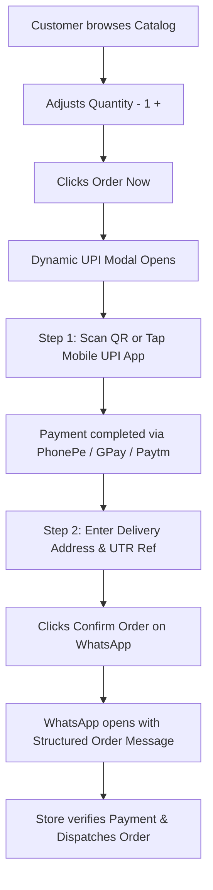

# ⚡ MR Enterprises — Premium Electrical Wholesale & Retail Storefront

[](https://developer.mozilla.org/en-US/docs/Web/HTML)
[](https://developer.mozilla.org/en-US/docs/Web/CSS)
[](https://developer.mozilla.org/en-US/docs/Web/JavaScript)
[](https://tailwindcss.com/)
[](https://wa.me/919648505055)
[](#-direct-upi--whatsapp-order-engine)

A high-converting, lightning-fast, **WhatsApp-First and Direct UPI-powered** e-commerce template designed specifically for electrical distributors, lighting showrooms, building material suppliers, and wholesale merchants.

Built with **Zero Backend Dependency** (100% pure HTML5, CSS3, and Vanilla JavaScript), allowing instant deployment on GitHub Pages, Netlify, Vercel, or any static web hosting.

---

## 🌟 Key Features & Capabilities

### 💳 1. Direct UPI Payment & WhatsApp Order Engine (0% Fees)
- **Zero Third-Party Gateway Deductions**: Eliminates intermediary gateway fees (Razorpay, Stripe, Cashfree) and KYC delays. Funds settle directly into the merchant's verified bank UPI account (`9648505055@upi`).
- **Dynamic QR Code Generation**: Generates a live, exact-amount UPI QR code using standard banking deep-link protocols. Compatible with PhonePe, Google Pay, Paytm, and BHIM.
- **1-Tap Mobile App Intent**: On mobile devices, buyers can tap a single button to launch their preferred UPI app with amount and recipient pre-filled.
- **2-Step Checkout Wizard**:
  - **Step 1**: Display scan-to-pay QR code, payment total, and UPI ID copy button.
  - **Step 2**: Capture delivery address (Name, Phone, Address Line textarea, City, State, PIN code) and optional 12-digit UTR payment reference number.
- **Auto-formatted WhatsApp Summary**: Dispatches a row-by-row verified order specification straight to the merchant's WhatsApp (+91 9648505055) for fast dispatch.

### 🛍️ 2. Comprehensive 8-Category Electrical Catalog
Curated 4:3 studio-quality full-width cards with smooth hover animations:
1. **LED Lighting** — Panels, Bulbs, Battens, Flood Lights
2. **Modular Switches** — Sockets, Plates, Dimmers, Regulators
3. **Ceiling & Wall Fans** — High-speed BLDC Fans, Exhaust Fans
4. **Wires & Cables** — Flame-retardant House Wires & Industrial Cables
5. **Geysers & Appliances** — Water Heaters, Immersion Rods, Mixers
6. **MCB & Switchgear** — Distribution Boards (DB), MCBs, RCCBs, Isolators
7. **Profile & Strip Lights** — Magnetic Track Lights, COB Downlights, LED Strips
8. **Pipes & Accessories** — PVC Conduits, Spike Guards, Extension Cords, Gang Boxes

### 🔍 3. Instant Search & Brand Filtering
- **Live Keystroke Search**: Searches product titles, brands, and categories in real time without refreshing the page.
- **Brand Tabs**: Quick filtering for top authorized electrical brands (**Havells**, **Polycab**, **Anchor**, **REO**, **Cona**).
- **Inline Quantity Selector (`- 1 +`)**: Allows customers to adjust quantities on the card, recalculating prices and UPI order links on the fly.

### 📱 4. Mobile-First Architecture
- **Dedicated Top Drawer Navigation**: Smooth slide-down overlay menu (`fixed inset-0 z-50`) with backdrop blur, prominent Close (✕) button, and body scroll lock.
- **Edge-to-Edge Hero Banners**: Adaptive responsive banners supporting widescreen 3:1 on desktop and high-impact 1:1 / 4:3 on mobile displays.
- **Sticky Contact Floating Action**: Quick access to WhatsApp inquiry and direct phone call buttons.

### 🖼️ 5. Store Showroom Lightbox
- Showcases the physical retail store and warehouse stock in Lucknow.
- Interactive modal with slide counters, zoom indicators, previous/next controls, touch swipe, and direct WhatsApp quote buttons.

### 📑 6. B2B Wholesale Quotation System
- Dedicated quote submission box for electrical contractors, builders, and large project orders with instant WhatsApp rate inquiries.

---

## 🔄 Customer Order & Payment Workflow



---

## 📁 Repository Structure

```text
frontend-static-template/
│
├── index.html                  # Main responsive storefront application
│
├── css/
│   └── style.css               # Theme overrides, custom animations, brand colors
│
├── js/
│   └── script.js               # Slider, search filter, UPI generator & WhatsApp handler
│
├── assets/
│   └── images/
│       ├── banners/            # Hero slider promotional banners
│       ├── brands/             # Brand logos (Havells, Polycab, Anchor, etc.)
│       ├── categories/         # 8 Studio category photography images
│       ├── products/           # Featured product photos
│       ├── promotional_banners/# Mid-page sale banners
│       └── store_gallery/      # Showroom & inventory showcase images
│
└── README.md                   # Project documentation
```

---

## 🚀 Quick Start Guide

### Running Locally
No server or build tools required:
1. Clone or download this repository:
   ```bash
   git clone https://github.com/oneroofweb/mr-enterprises.git
   ```
2. Navigate into the folder:
   ```bash
   cd mr-enterprises
   ```
3. Open `index.html` directly in any web browser (Chrome, Safari, Edge, Firefox).

---

## ⚙️ Configuration & Customization

All merchant business settings can be updated in seconds:

### 1. Update Merchant Contact & UPI Details
Open `js/script.js` and locate the configuration variables:
```javascript
// Store UPI ID for Direct Banking Transfers
const STORE_UPI_ID = "9648505055@upi";
const STORE_MERCHANT_NAME = "MR Enterprises";

// WhatsApp Number (with country code, no + or spaces)
const STORE_WHATSAPP_NUMBER = "919648505055";
```

### 2. Update Store Address & Hours
In `index.html`, update the top bar and footer sections:
- **Location**: Kamlapur Tiraha, Madi Road, Bijnor, Lucknow, Uttar Pradesh
- **Phone**: +91 9648505055
- **Store Hours**: Monday – Saturday: 9:00 AM – 8:30 PM

---

## 🎨 Brand Design System

| Element | Color Code | Tailwind Utility | Usage |
|---|---|---|---|
| **MR Navy Blue** | `#0a1d48` | `bg-mr-blue`, `text-mr-blue` | Primary headers, navbars, buttons |
| **Accent Red** | `#e31e24` | `bg-mr-red`, `text-mr-red` | Hot deals, badges, logo accents |
| **WhatsApp Green** | `#25D366` | `bg-[#25D366]` | Checkout CTA, WhatsApp buttons |
| **Electric Amber** | `#f59e0b` | `text-amber-500`, `text-yellow-400` | Highlights, ratings, catalog links |
| **Background Light** | `#f8fafc` | `bg-slate-50`, `bg-gray-50` | Clean high-contrast card canvases |

---

## 🌐 Deploying to GitHub Pages

1. Push this repository to GitHub:
   ```bash
   git add .
   git commit -m "feat: complete MR Enterprises static template"
   git push origin main
   ```
2. In your GitHub repository, navigate to **Settings** > **Pages**.
3. Under **Branch**, select `main` and root directory `/`, then click **Save**.
4. Your storefront will be live within seconds at:
   `https://oneroofweb.github.io/mr-enterprises/`

---

## 📄 License & Credits

- **Client**: MR Enterprises (Electrical Goods, Lighting & Accessories), Lucknow, UP.
- **Design & Development**: Built with ❤️ by [One Roof Web](https://github.com/oneroofweb).
- **License**: Private / Proprietary commercial usage for MR Enterprises.
